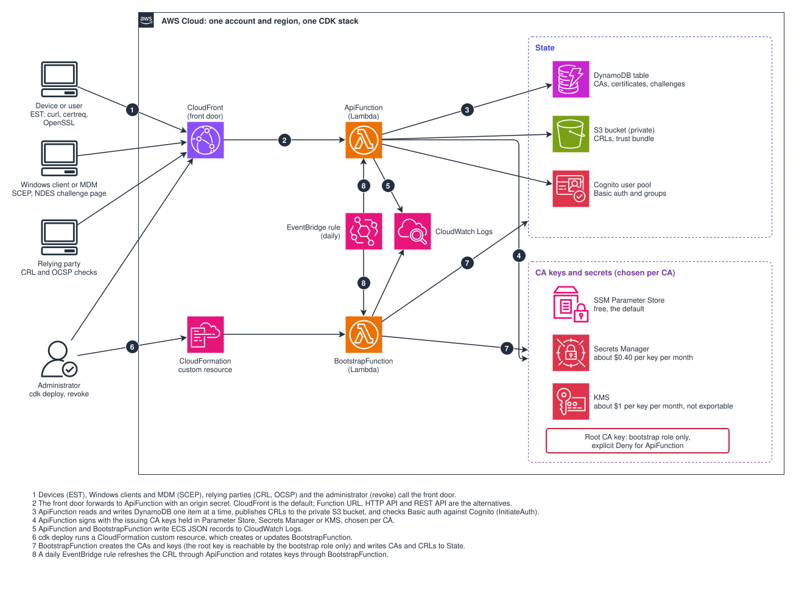

# aws-ca

## Background

A certificate authority (CA) that runs on AWS Lambda, as a more cost efficient alternative to
[AWS Private Certificate Authority](https://docs.aws.amazon.com/privateca/). It issues client
certificates using [SCEP](https://datatracker.ietf.org/doc/html/rfc8894) and
[Enrollment over Secure Transport](https://datatracker.ietf.org/doc/html/rfc7030) (EST), issues server
certificates using EST, and answers [OCSP](https://datatracker.ietf.org/doc/html/rfc6960) and publishes
a CRL for revocation.

The keys of the CAs can be kept in Parameter Store (free), Secrets Manager (about $0.40 USD per month
per key) or KMS (about $1 USD per month per key), chosen per CA.



The design is in [docs/system-design/](docs/system-design/index.md).

## Quick Start

Requires Node.js 24 and AWS credentials for an account and region that is
[bootstrapped for the CDK](https://docs.aws.amazon.com/cdk/v2/guide/bootstrapping.html).

```shell
npm install
cp aws-ca.config.example.ts aws-ca.config.ts
npm run cdk:deploy
```

The deployment prints the endpoints and the `UserPoolId` of the Cognito User Pool that authenticates
users with `Basic` authentication. The following commands create a user that can enroll client
certificates.

```shell
aws cognito-idp admin-create-user \
    --user-pool-id <YOUR_COGNITO_USER_POOL_ID> \
    --username <USERNAME> \
    --message-action SUPPRESS

aws cognito-idp admin-set-user-password \
    --user-pool-id <YOUR_COGNITO_USER_POOL_ID> \
    --username <USERNAME> \
    --password <PASSWORD> \
    --permanent

aws cognito-idp admin-add-user-to-group \
    --user-pool-id <YOUR_COGNITO_USER_POOL_ID> \
    --username <USERNAME> \
    --group-name est-client
```

| Group        | Allows the user to                                                    |
| ------------ | --------------------------------------------------------------------- |
| `est-client` | enroll a client certificate, for their own user name                  |
| `est-server` | enroll a server certificate, for names within `allowedDomainSuffixes` |
| `est-admin`  | revoke any certificate, and request SCEP challenges                   |
| `scep-admin` | request SCEP challenges, for example the account a MDM uses           |

## Endpoints

```shell
https://xyz.cloudfront.net/.well-known/est/issuing/simpleenroll
```

`issuing` is the label of the CA, which can be left out to use the first one. The outputs of the
deployment (`EstEndpoint`, `ScepEndpoint`, `RevocationBaseUrl`, ...) give the addresses.

### EST

Authenticated with `Basic` authentication. Re-enrollment can instead present the certificate being
renewed, if the front door is configured with mTLS.

| Operation                       | Method | Operation Path                         |
| ------------------------------- | ------ | -------------------------------------- |
| Distribution of CA Certificates | GET    | `/.well-known/est/<ca>/cacerts`        |
| Enrollment of Clients           | POST   | `/.well-known/est/<ca>/simpleenroll`   |
| Re-enrollment of Clients        | POST   | `/.well-known/est/<ca>/simplereenroll` |

The same paths are available under `/est/<ca>/...`.

### SCEP

Authenticated with the challenge, or by signing a renewal with the certificate being renewed.

| Operation                  | Method   | Operation Path                    | Authentication         |
| -------------------------- | -------- | --------------------------------- | ---------------------- |
| SCEP                       | GET/POST | `/scep/<ca>/pkiclient.exe`        | challenge              |
| SCEP Challenge (NDES page) | GET      | `/scep/<ca>/certsrv/mscep_admin/` | `Basic` (`scep-admin`) |
| SCEP Challenge (JSON)      | POST     | `/ca/<ca>/scep/challenge`         | `Basic` (`scep-admin`) |

### Revocation

| Operation                   | Method   | Operation Path                      | Authentication                 |
| --------------------------- | -------- | ----------------------------------- | ------------------------------ |
| Revoke Client               | POST     | `/ca/<ca>/revoke`                   | `Basic` (owner or `est-admin`) |
| Certificate Revocation List | GET      | `/crl/<ca>.crl`                     | none                           |
| OCSP Responder              | GET/POST | `/ocsp/<ca>`, `/ocsp/<ca>/<base64>` | none                           |

The default front door is CloudFront, which can serve the CRL and OCSP over HTTP. The other front
doors (`function-url`, `http-api` and `rest-api`) only serve HTTPS, so the OCSP responder is a HTTPS
uri. See [ADR 0009](docs/adr/0009-configurable-front-door-and-viewer-mtls.md) for what each front door costs and supports.

## Configuration

The stack is configured in `aws-ca.config.ts`. Every option is optional except
`policy.allowedDomainSuffixes`, which is needed while a CA issues server certificates. An invalid
configuration fails `cdk synth` and lists every problem. `AWS_CA_CONFIG` selects another file and
`AWS_CA_STACK_NAME` another stack name.

| Option                          | Description                                                                                          | Default                         |
| ------------------------------- | ---------------------------------------------------------------------------------------------------- | ------------------------------- |
| `namePrefix`                    | Prefix of the parameter and secret names                                                             | `/private-ca`                   |
| `removalPolicy`                 | `retain` keeps the table and keys when the stack is deleted, `destroy` removes them                  | `retain`                        |
| `rootCa`                        | `subject`, `algorithm`, `keyStore`, `validityYears`, `keyHandling` (`retain` or `offline`)           | ECDSA P-256, 20 years, `retain` |
| `subordinateCas`                | `label`, `profiles`, `subject`, `algorithm`, `keyStore`, `validityYears` of each issuing CA          | one `issuing` CA, both profiles |
| `operationalKey`                | The RSA key that SCEP decrypts with: `backend`, `protection`, `modulusLength`, `validityDays`        | RSA 2048, 365 days              |
| `scep.enabled`                  | Serve SCEP                                                                                           | `true`                          |
| `scep.challenge`                | `static` (shared secret), `dynamic` (single use, requested per device) or `both`                     | `both`                          |
| `scep.dynamicChallenge`         | `validityMinutes`, `maxOutstanding`, `lengthBytes`                                                   | 60, 100, 8                      |
| `ocsp`                          | `enabled`, `signing` (`operational`, `kms` or `ca`), `maxAgeSeconds`, `nextUpdateHours`              | enabled, `operational`, 3600, 4 |
| `crl.nextUpdateDays`            | Days until the CRL says it is updated (it is rebuilt on every revocation and daily)                  | `7`                             |
| `lifetimes`                     | `clientDays` and `serverDays`, the validity of issued certificates                                   | 365, 90                         |
| `retention.afterExpiryDays`     | Days an expired certificate is kept in the table                                                     | `90`                            |
| `policy.allowedDomainSuffixes`  | Server certificates are only issued for names within these                                           |                                 |
| `policy.subjectTemplate`        | Subject of client certificates, `{username}` is the authenticated user                               | `CN={username}`                 |
| `groups`                        | Names of the Cognito groups: `client`, `server`, `admin` and `scep`                                  | as above                        |
| `auth.cognitoTier`              | `lite` or `essentials`                                                                               | `lite`                          |
| `frontDoor`                     | `type` (`cloudfront`, `function-url`, `http-api`, `rest-api`), `mtls`, `domain` and REST API options | `cloudfront`                    |
| `frontDoor.originSecretVersion` | CloudFront only. Raise it and deploy to rotate the secret between CloudFront and the origin          | `1`                             |
| `logging.clientDetails`         | Log the address and user agent of the caller                                                         | `true`                          |

The key store of a CA is `keyStore: { backend, protection }`. The `backend` is `parameter`, `secret`
or `kms`. For `parameter` and `secret` the `protection` is `aws-managed-key`, `app-encrypted` (the
default, encrypted with a separate secret so the key cannot be seen in the console) or
`customer-managed-key`.

```ts
import { defineConfig } from './src/config';

export default defineConfig({
  policy: { allowedDomainSuffixes: ['example.internal'] },
  rootCa: { keyStore: { backend: 'parameter', protection: 'app-encrypted' } },
  subordinateCas: [{ label: 'issuing', keyStore: { backend: 'kms' } }],
  scep: { challenge: 'dynamic' },
});
```

The static SCEP challenge is a shared secret, so anyone with it can obtain a certificate for any name.
With `dynamic`, a challenge is single use and expires, and is requested by a user in `scep-admin`,
either from the NDES page (`/scep/<ca>/certsrv/mscep_admin/`) that MDMs such as Workspace ONE read,
or from `/ca/<ca>/scep/challenge` that can bind the challenge to a common name.

## Resources

| Logical ID          | Type                            | Description                                                |
| ------------------- | ------------------------------- | ---------------------------------------------------------- |
| `Table`             | `AWS::DynamoDB::Table`          | Stores the certificate authorities and the certificates    |
| `CrlBucket`         | `AWS::S3::Bucket`               | Stores the certificate revocation lists                    |
| `UserPool`          | `AWS::Cognito::UserPool`        | Authenticates the users                                    |
| `ApiFunction`       | `AWS::Lambda::Function`         | Serves EST, SCEP, OCSP, CRL and revocation                 |
| `BootstrapFunction` | `AWS::Lambda::Function`         | Creates the CAs and keys, and rotates the operational keys |
| `CrlRefresh`        | `AWS::Events::Rule`             | Rebuilds the CRLs daily                                    |
|                     | `AWS::CloudFront::Distribution` | The front door, unless another `frontDoor` is configured   |

Parameters are used for the keys if the `backend` is `parameter`. Note that standard tier
parameters are free.

| Name                                     | Type                  | Description                                                     |
| ---------------------------------------- | --------------------- | --------------------------------------------------------------- |
| `/private-ca/ca/root/key`                | `AWS::SSM::Parameter` | The encrypted private key of the Root CA as a `SecureString`    |
| `/private-ca/ca/<label>/key`             | `AWS::SSM::Parameter` | The encrypted private key of an issuing CA as a `SecureString`  |
| `/private-ca/ca/<label>-ops/<id>/key`    | `AWS::SSM::Parameter` | The operational key of an issuing CA, replaced as it expires    |
| `/private-ca/internal/encryption-secret` | `AWS::SSM::Parameter` | Encrypts the keys when `protection` is `app-encrypted`          |
| `/private-ca/internal/scep-challenge`    | `AWS::SSM::Parameter` | The static SCEP challenge, unless `scep.challenge` is `dynamic` |

Secrets are used for the keys if the `backend` is `secret`. Note that each secret costs $0.40 USD
per month.

| Name                        | Type                          | Description                                |
| --------------------------- | ----------------------------- | ------------------------------------------ |
| `private-ca/ca/root/key`    | `AWS::SecretsManager::Secret` | The encrypted private key of the Root CA   |
| `private-ca/ca/<label>/key` | `AWS::SecretsManager::Secret` | The encrypted private key of an issuing CA |

KMS keys are used if the `backend` is `kms`. Note that each key costs $1 USD per month, and the key
cannot be exported.

| Alias                  | Type            | Description              |
| ---------------------- | --------------- | ------------------------ |
| `alias/aws-ca/root`    | `AWS::KMS::Key` | The Root CA key          |
| `alias/aws-ca/<label>` | `AWS::KMS::Key` | The key of an issuing CA |

### Destroy Resources

The following command will destroy the resources, otherwise costs will be incurred.

```shell
npm run cdk:destroy
```

With `removalPolicy` set to `retain`, which is the default, the table and the keys are kept because
deleting them loses the CA. Set it to `destroy` for experiments.

## Certificate Signing Request

The subject common name of a client certificate must be the name of the authenticated user, and the
rest of the subject is replaced by the `policy.subjectTemplate`. Server certificates take the DNS
names from the `subjectAltName` extension, which must be within the `allowedDomainSuffixes`.

### Windows

When using Windows the [`certreq`](https://learn.microsoft.com/en-us/windows-server/administration/windows-commands/certreq_1) application can be used to generate the CSR using an `inf` configuration file.

The private key will stored in the Windows certificate store in the `Certificate Enrollment Requests` folder in either the `Current User` or `Local Computer` certificate store if `MachineKeySet` is `TRUE`.

Note that Browsers will only use client certificates under `Personal` in the `Current User` certificate store.

The `certlm.msc` command can be used to open the `Local Computer` certificate store in Windows.

The `certmgr.msc` command can be used to open the `Current User` certificate store in Windows.

The following command can be used to generate a new request from an `inf` configuration file.

```shell
certreq -new config.inf client.csr
```

```ini
[Version]
Signature= "$Windows NT$"

[NewRequest]
Subject = "CN=<USERNAME>"
KeySpec = AT_KEYEXCHANGE
KeyLength = 2048
Exportable = false
MachineKeySet = false
SMIME = false
PrivateKeyArchive = false
UserProtected = false
UseExistingKeySet = false
ProviderName = "Microsoft RSA SChannel Cryptographic Provider"
ProviderType = 12
RequestType = PKCS10
KeyUsage = 0xa0
HashAlgorithm = SHA256
SuppressDefaults = true

[EnhancedKeyUsageExtension]
OID=1.3.6.1.5.5.7.3.2
```

The following command is used to link the previously generated private key with the issued certificate and removes the pending certificate request from the system.

This requires administrative privileges if `MachineKeySet` is `TRUE`.

```shell
certreq -accept certificates.p7b
```

Note that the certificate chain needs to already be installed in the certificate store in Windows otherwise the following error will be displayed.

```
A certificate issued by the certification authority cannot be installed. Contact your administrator.
A certificate chain could not be built to a trusted root authority. 0x800b010a (-2146762486 CERT_E_CHAINING)
```

### OpenSSL

```shell
openssl ecparam -name prime256v1 -genkey -noout -out clientkey.pem
openssl req -new -key clientkey.pem -subj "/CN=<USERNAME>" -out client.csr
```

## Certificate Enrollment

### EST

#### Windows

```shell
$Endpoint = "https://xyz.cloudfront.net/.well-known/est/issuing/"
curl.exe --location --request POST $Endpoint'simpleenroll' --user $Username':'$Password --header 'Content-Type: application/pkcs10' --data-binary "@$CsrPath" --output $CertPath
```

#### OpenSSL

```shell
export Endpoint="https://xyz.cloudfront.net/.well-known/est/issuing/"
curl --location --request POST ${Endpoint}'simpleenroll' --user ${Username}':'${Password} --header 'Content-Type: application/pkcs10' --data-binary "@$CsrPath" --output $CertPath
```

The response is a base64 encoded PKCS#7 with the certificate and the issuing CA.

### SCEP

#### Windows

The [PSCertificateEnrollment](https://www.powershellgallery.com/packages/PSCertificateEnrollment)
module enrolls using the SCEP client of Windows. The challenge is either the static challenge, which
is in the parameter that the `ScepChallengeParameter` output names, or a dynamic one from the NDES
page.

```shell
Install-Module PSCertificateEnrollment -Scope CurrentUser

# static challenge
$Challenge = aws ssm get-parameter --name /private-ca/internal/scep-challenge --with-decryption --query Parameter.Value --output text

# dynamic challenge, with a user in the scep-admin group
$Challenge = Get-NDESOTP -ComputerName $HostName -Suffix 'scep/issuing/certsrv/mscep_admin' -Credential $Username -BasicAuthentication

Get-SCEPCertificate -ComputerName $HostName -UseSSL -Suffix 'scep/issuing' -ChallengePassword $Challenge -Subject 'CN=DeviceUid' -KeyAlgorithm RSA -KeyLength 2048
```

Renewal is signed with the certificate that was issued, so it does not need a challenge.

```shell
Get-SCEPCertificate -ComputerName $HostName -UseSSL -Suffix 'scep/issuing' -SigningCert (Get-Item Cert:\CurrentUser\My\<THUMBPRINT>) -KeyAlgorithm RSA -KeyLength 2048
```

More commands, including EST from the Windows client, are in [docs/windows-enrollment.md](docs/windows-enrollment.md).

## Certificate Revocation

The owner of the certificate, or a user in `est-admin`, can revoke a certificate using its serial
number. The reason is optional and is one of `unspecified`, `keyCompromise`, `affiliationChanged`,
`superseded`, `cessationOfOperation` or `privilegeWithdrawn`.

### Windows

```shell
$Endpoint = "https://xyz.cloudfront.net/"
curl.exe --location --request POST $Endpoint'ca/issuing/revoke' --user $Username':'$Password --header 'Content-Type: application/json' --data "{\"serialNumber\":\"$SerialNumber\",\"reason\":\"keyCompromise\"}"
```

### OpenSSL

```shell
export Endpoint="https://xyz.cloudfront.net/"
curl --location --request POST ${Endpoint}'ca/issuing/revoke' --user ${Username}':'${Password} --header 'Content-Type: application/json' --data "{\"serialNumber\":\"${SerialNumber}\",\"reason\":\"keyCompromise\"}"
```

The CRL is rebuilt at once and OCSP answers from the same data.

```shell
openssl ocsp -issuer issuing.pem -cert client.pem -url "http://xyz.cloudfront.net/ocsp/issuing" -CAfile chain.pem
```

## More Information

- [docs/operations.md](docs/operations.md): rotating secrets, adding CAs, users and troubleshooting
- [docs/windows-enrollment.md](docs/windows-enrollment.md): enrolling from Windows with its own clients
- [docs/logging.md](docs/logging.md): the ECS log schema and example queries
- [docs/system-design/](docs/system-design/index.md): the architecture (arc42)
- [docs/adr/](docs/adr/): the decisions and the reasons for them
