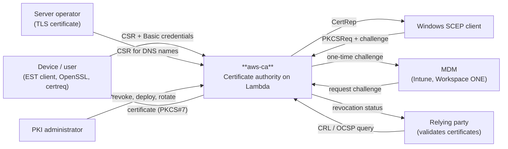
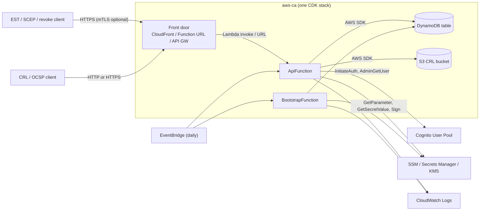

# 3. Context and Scope

## 3.1 Business Context

<!-- arc42-generated -->

| Communication partner | Input                                                     | Output                                                    |
| --------------------- | --------------------------------------------------------- | --------------------------------------------------------- |
| Device / user         | PKCS#10 CSR, Basic credentials (or a client certificate)  | Certificate and issuing CA as certs-only PKCS#7           |
| Windows SCEP client   | `GetCACaps`, `GetCACert`, `PKIOperation` with a challenge | CA/RA certificates, `CertRep` with the issued certificate |
| MDM                   | Basic credentials of a `scep-admin` user                  | One-time SCEP challenge (NDES HTML page or JSON)          |
| Server operator       | CSR with DNS/IP names, Basic credentials in `est-server`  | Server certificate (default 90 days)                      |
| PKI administrator     | `aws-ca.config.ts`, `cdk deploy`, revoke requests         | Stack outputs, root fingerprint, offline root key         |
| Relying party         | CRL download, OCSP request                                | DER CRL, signed OCSP response                             |

<!-- /arc42-generated -->

## 3.2 Technical Context

<!-- arc42-generated -->

| Interface      | Protocol                                                                    | Format                                                   | Notes                                                                                                             |
| -------------- | --------------------------------------------------------------------------- | -------------------------------------------------------- | ----------------------------------------------------------------------------------------------------------------- |
| EST            | HTTPS, `/.well-known/est/<ca>/…`                                            | `application/pkcs10`, PKCS#7 certs-only                  | Also served under `/est/<ca>/…`; Basic, or the presented certificate for re-enrollment.                           |
| SCEP           | HTTP(S) GET/POST `/scep/<ca>/pkiclient.exe`                                 | `application/x-pki-message` (CMS)                        | RSA operational key decrypts requests; challenge or signed renewal authenticates.                                 |
| SCEP challenge | HTTPS GET `/scep/<ca>/certsrv/mscep_admin/`, POST `/ca/<ca>/scep/challenge` | UTF-16LE HTML, JSON                                      | `Basic` for `scep-admin` / `est-admin`.                                                                           |
| Revocation     | HTTPS POST `/ca/<ca>/revoke`                                                | JSON `{serialNumber, reason}`                            | Owner or `est-admin`.                                                                                             |
| CRL            | HTTP(S) GET `/crl/<ca>.crl`                                                 | DER CRL                                                  | Read from the private S3 bucket and served by `ApiFunction`; CloudFront caches it per the origin `Cache-Control`. |
| OCSP           | HTTP(S) GET/POST `/ocsp/<ca>[/<b64>]`                                       | DER OCSP request/response                                | HTTP only on the CloudFront level; cacheable GET.                                                                 |
| Cognito        | AWS SDK                                                                     | `InitiateAuth`, `AdminGetUser`, `AdminListGroupsForUser` | Sign-in needs no IAM grant; lookups are read only and scoped to the pool.                                         |
| Key stores     | AWS SDK                                                                     | SSM SecureString, Secrets Manager, KMS `Sign`            | Runtime role reaches issuing CA keys only; explicit `Deny` for the root.                                          |
| DynamoDB / S3  | AWS SDK                                                                     | Single-item operations; `crl/*` objects                  | No scan and no batch from the request path.                                                                       |

<!-- /arc42-generated -->
