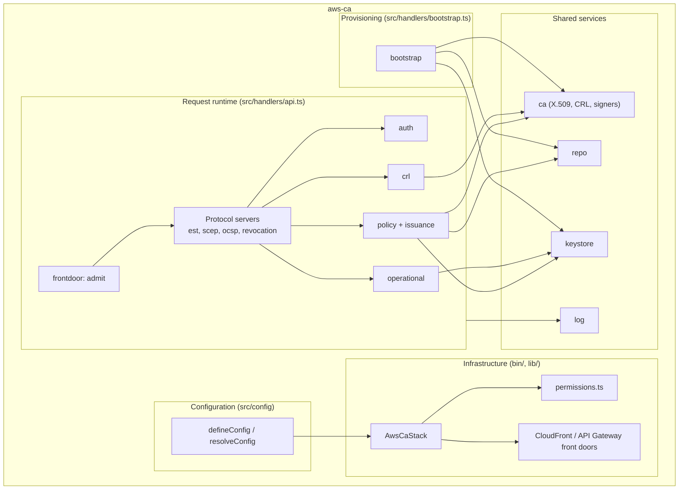
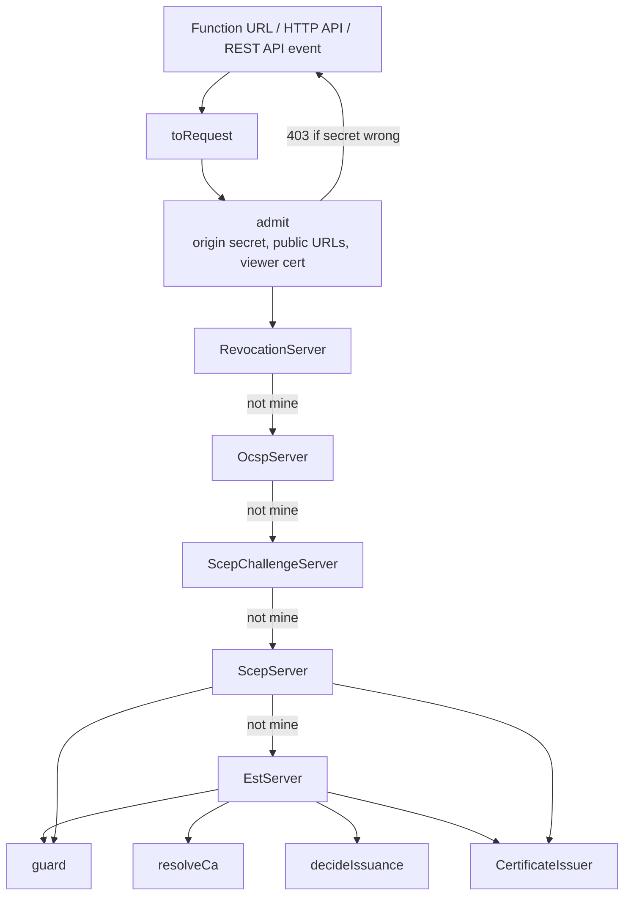
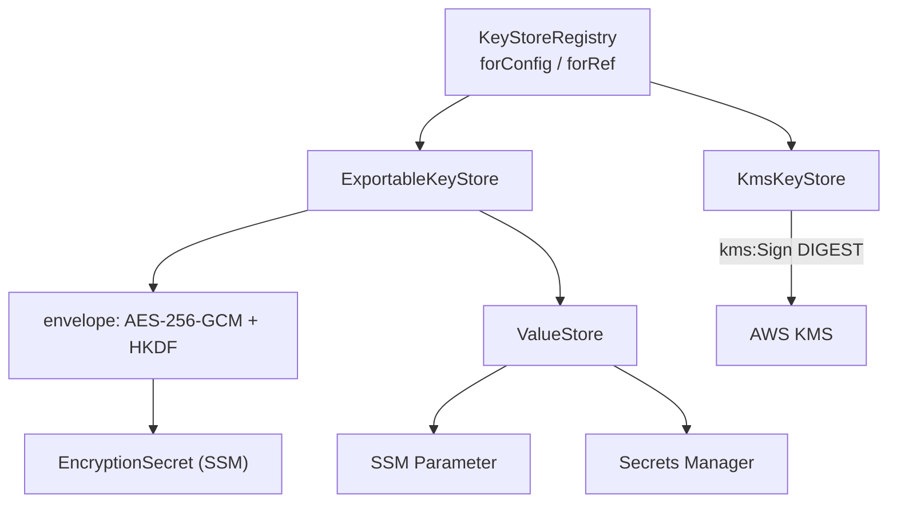

# 5. Building Block View

## 5.1 Whitebox Overall System (Level 1)

<!-- arc42-generated -->

**Motivation:** Two deployable units (the API function and the bootstrap function) share one
code base. The split exists for privilege: only the bootstrap can use the root key and create keys.

### Contained Building Blocks

| Building Block        | Responsibility                                                                                            | Interfaces                                                 | Code Location                                  |
| --------------------- | --------------------------------------------------------------------------------------------------------- | ---------------------------------------------------------- | ---------------------------------------------- |
| CDK app               | Entry point; loads and validates configuration, creates `AwsCaStack`.                                     | `AWS_CA_CONFIG`, `AWS_CA_STACK_NAME`                       | [bin/aws-ca.ts](../../bin/aws-ca.ts)           |
| Stack and front doors | Table, bucket, user pool, both Lambdas and roles, custom resource, daily rule, CloudFront or API Gateway. | CloudFormation outputs                                     | [lib/](../../lib)                              |
| Permissions           | IAM statements for key access: runtime vs. admin, explicit root `Deny`.                                   | `keyAccessStatements`, `rootKeyDenyStatements`             | [lib/permissions.ts](../../lib/permissions.ts) |
| Configuration         | Typed input, defaults, validation that reports every problem with its path.                               | `defineConfig`, `resolveConfig`, `ResolvedConfig`          | [src/config](../../src/config)                 |
| Front door admission  | Verifies the origin secret first; applies published public URLs and the viewer certificate header.        | `admit`, `OriginSecretSource`                              | [src/frontdoor](../../src/frontdoor)           |
| EST server            | `cacerts`, `simpleenroll`, `simplereenroll`.                                                              | `EstServer.handle`                                         | [src/est](../../src/est)                       |
| SCEP server           | `GetCACaps`, `GetCACert(Chain)`, `PKIOperation` (PKCSReq, RenewalReq, GetCert); CMS codec; challenges.    | `ScepServer`, `ScepChallengeServer`, `DynamicChallenges`   | [src/scep](../../src/scep)                     |
| OCSP server           | Decode request, look up status, sign a response with the delegated key.                                   | `OcspServer.handle`                                        | [src/ocsp](../../src/ocsp)                     |
| Revocation server     | `POST /ca/<ca>/revoke` and CRL serving.                                                                   | `RevocationServer.handle`                                  | [src/revocation](../../src/revocation)         |
| CRL service           | Build the CRL from the database, number it, publish conditionally, refresh daily.                         | `CrlService`, `S3CrlStore`                                 | [src/crl](../../src/crl)                       |
| Authentication        | Basic header → Cognito `InitiateAuth`; user and group lookup for certificate-based renewal.               | `Authenticator`, `CognitoAuthenticator`                    | [src/auth](../../src/auth)                     |
| Issuance policy       | Decide profile, subject, SANs and lifetime from user, groups and CSR.                                     | `decideIssuance`, `decideScepIssuance`                     | [src/policy](../../src/policy)                 |
| Certificate issuer    | Sign, record, and log every issued certificate; common to EST and SCEP.                                   | `CertificateIssuer.issue`                                  | [src/issuance](../../src/issuance)             |
| CA library            | Certificate, CSR and CRL construction, serial numbers, signers, KMS `CryptoKey` adapter.                  | `issueCertificate`, `createRootCa`, `parseCsr`, `Signer`   | [src/ca](../../src/ca)                         |
| Operational keys      | Create, rotate and load the delegated RSA (SCEP/OCSP) and KMS (OCSP) keys.                                | `OperationalKeyService`                                    | [src/operational](../../src/operational)       |
| Key stores            | `CaKeyStore` over SSM, Secrets Manager (exportable) and KMS; envelope encryption; registry by `keyRef`.   | `CaKeyStore`, `KeyStoreProvider`, `KeyRef`                 | [src/keystore](../../src/keystore)             |
| Repository            | DynamoDB single-table persistence of CAs, certificates, operational certificates, CRL number, challenges. | `CaRepository`, `DynamoCaRepository`, `MemoryCaRepository` | [src/repo](../../src/repo)                     |
| Bootstrap             | Idempotent, race-safe creation of root and issuing CAs, offline root export, teardown.                    | `bootstrapCas`, `teardownCas`                              | [src/bootstrap](../../src/bootstrap)           |
| Serving helpers       | CA resolution and the `guard` that turns exceptions into protocol responses.                              | `resolveCa`, `guard`                                       | [src/serving](../../src/serving)               |
| HTTP types / helpers  | Provider-neutral request/response, body limits, constant-time compare.                                    | `HttpRequest`, `HttpResponse`                              | [src/http](../../src/http)                     |
| Logger                | ECS 8.11 records from a closed catalogue, with request-scoped context.                                    | `createLogger`, `withLogContext`                           | [src/log.ts](../../src/log.ts)                 |
| Handlers              | Lambda entry points; wire dependencies; adapt Function URL / HTTP API / REST API events.                  | `handler` (API, bootstrap)                                 | [src/handlers](../../src/handlers)             |

<!-- /arc42-generated -->

## 5.2 Level 2

### Request runtime (White Box)

<!-- arc42-generated -->

| Component           | Responsibility                                                                                                                                        |
| ------------------- | ----------------------------------------------------------------------------------------------------------------------------------------------------- |
| `toRequest`         | Normalise the three event shapes (payload v1 and v2); client certificate from request context only if configured.                                     |
| `admit`             | First check of every request: origin secret, then published base URLs and the viewer certificate header.                                              |
| Router chain        | `handle` returns `undefined` for paths it does not own; EST is the final handler. Each server owns its path prefixes.                                 |
| `guard`             | Turns authentication errors (429/503), protocol-mapped errors and unexpected failures into responses; logs unexpected ones once as `process_request`. |
| `CertificateIssuer` | One place that signs, records (before returning) and logs; EST and SCEP both end here.                                                                |

<!-- /arc42-generated -->

### Key store (White Box)

<!-- arc42-generated -->

| Component            | Responsibility                                                                                                                                 |
| -------------------- | ---------------------------------------------------------------------------------------------------------------------------------------------- |
| `KeyStoreRegistry`   | Chooses a store by configuration for new keys and by the CA record's `keyRef` for existing ones; the record is authoritative.                  |
| `ExportableKeyStore` | One class parameterised by the value store; applies the configured protection; verifies the loaded key against the public key in the `keyRef`. |
| `KmsKeyStore`        | Non-exportable key; signs digests, converts DER signatures to P1363 for WebCrypto; alias per CA and generation.                                |
| Envelope             | `app-encrypted` format; key derived by HKDF from the random encryption secret kept in a separate SSM parameter.                                |

<!-- /arc42-generated -->

## 5.3 Level 3

<!-- arc42-manual: Further decompose Level 2 blocks where needed for complex or risky components (for example src/scep/cms.ts) -->
<!-- /arc42-manual -->
