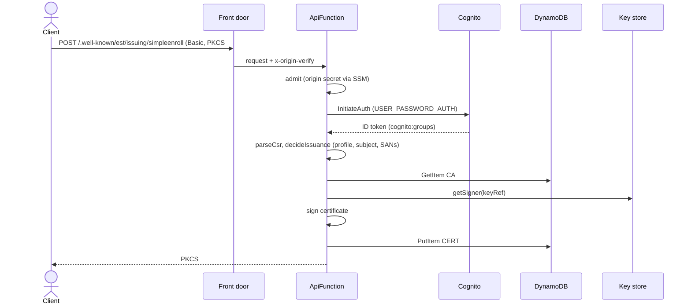
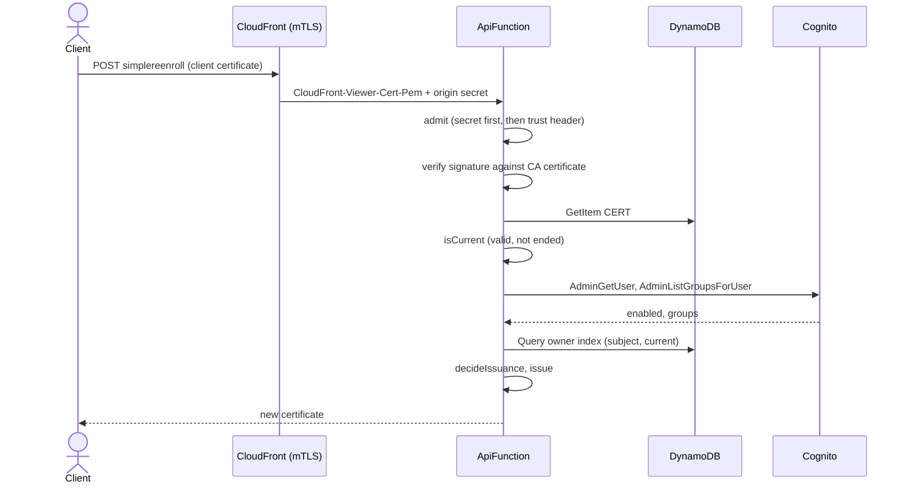
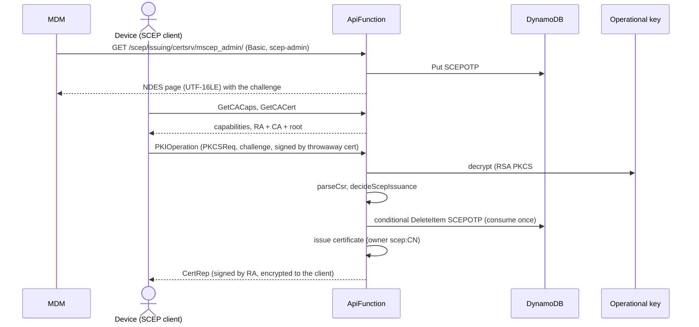
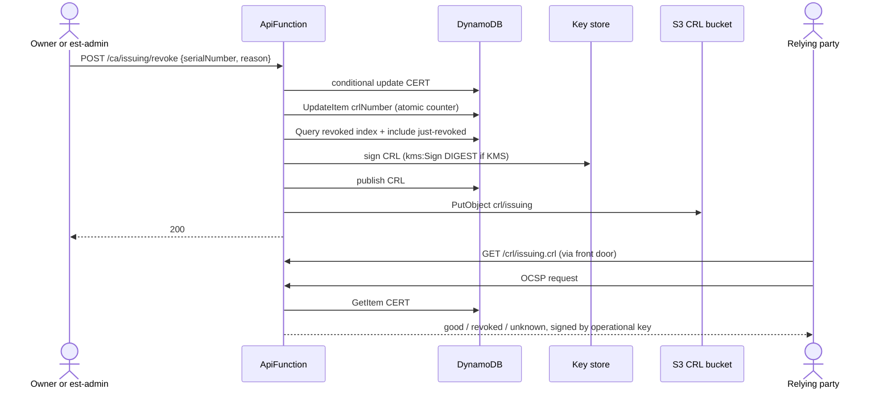
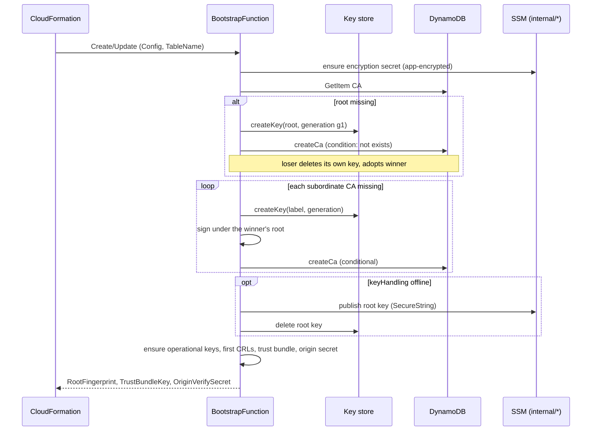

# 6. Runtime View

Scenarios were chosen for architectural relevance: the two enrollment protocols, the revocation
chain, the one place a CA is created, and the paths where trust is decided.

## 6.1 Scenario: EST enrollment with Basic authentication

<!-- arc42-generated -->

**Overview:** The default way a client or server obtains a certificate. Shows where trust is decided: origin secret, Cognito, group-to-profile policy, and the rule that the CSR never chooses the subject.

**Steps:**

1. The front door forwards the request with the origin secret header; `admit` rejects it with 403 if the secret is wrong.
2. `Authorization: Basic` becomes a Cognito `InitiateAuth`; the group claim selects what the user may enroll.
3. A request with DNS or IP names is a `server` request, anything else is `client`; the user must be in that profile's group and the CA must carry the profile.
4. The subject comes from `policy.subjectTemplate` and the authenticated user (client) or the first DNS name (server), never from the CSR.
5. The certificate is signed, **recorded before it is returned**, and an `issue_certificate` record is logged.

<!-- /arc42-generated -->

## 6.2 Scenario: EST re-enrollment with the certificate being renewed

<!-- arc42-generated -->

**Overview:** With front-door mTLS, a device renews without a password. The trust store only checks the chain, so status, expiry and the user's standing are checked by the Lambda.

**Steps:** Any failed check answers 401 with no detail. A disabled or de-grouped user cannot keep renewing, although certificates already issued stay valid until they expire or are revoked.

<!-- /arc42-generated -->

## 6.3 Scenario: SCEP enrollment with a dynamic challenge

<!-- arc42-generated -->

**Overview:** An MDM obtains a one-time challenge, hands it to the device, and the device enrolls. Shows the RA key, the single-use consume and the renewal path.

**Steps:**

1. The static challenge, when allowed, is compared in constant time and never consumed; a dynamic challenge is consumed by one conditional delete after the request passed policy.
2. Every challenge failure is the same `badRequest` to the client; the log carries the reason class (`unknown`, `expired`, `bound`, `mismatch`, `missing`) but never the value.
3. Renewal is a `RenewalReq` signed by a certificate this CA issued whose owner starts with `scep:` and whose subject matches; it needs no challenge.

<!-- /arc42-generated -->

## 6.4 Scenario: Revocation, CRL and OCSP

<!-- arc42-generated -->

**Overview:** Revocation is synchronous and the CRL is rebuilt from the database, not by editing the previous CRL, so concurrent revocations cannot lose entries.

**Rules:** The caller may give `unspecified` (default), `keyCompromise`, `affiliationChanged`, `superseded`, `cessationOfOperation` or `privilegeWithdrawn`; `certificateHold` and `removeFromCRL` are refused because they would make revocation undoable. A certificate the caller does not own (and who is not in the admin group) answers as not found; revoking twice answers 409. If the CRL cannot be rebuilt at once the revocation still stands and the log says `crl_pending`; the next revocation or daily refresh includes it.

**Steps:** The CRL number is taken before the list is read, so the higher number always saw the other revocation. OCSP answers can lag a revocation by up to `ocsp.maxAgeSeconds` where CloudFront caches them; an expired but unremoved certificate is `good`, a serial this CA never issued is `unknown`.

<!-- /arc42-generated -->

## 6.5 Scenario: Bootstrap on deploy

<!-- arc42-generated -->

**Overview:** The only path that creates a CA or a key. It is a CloudFormation custom resource and safe to repeat and to run concurrently.

**Steps:** Each attempt names its keys with a fresh generation id, so a crash leaves at worst an unreferenced key under a unique name. Hand-over of the offline root key precedes its removal. Running again with nothing to do changes nothing; adding a subordinate CA to the configuration creates only that CA.

<!-- /arc42-generated -->

## 6.6 Scenario: Daily maintenance

<!-- arc42-generated -->

**Overview:** An EventBridge rule runs every day and invokes both functions so that nothing expires unnoticed.

| Step | Function            | Action                                                                                                                                     |
| ---- | ------------------- | ------------------------------------------------------------------------------------------------------------------------------------------ |
| 1    | `ApiFunction`       | `CrlService.refreshAll` for the issuing CAs; throws if any CA failed so the invocation is visibly in error.                                |
| 2    | `BootstrapFunction` | Refreshes the root CA's CRL (unless the root is offline, see `maintainedCrlLabels`) and rotates operational keys within 30 days of expiry. |

<!-- /arc42-generated -->

## 6.7 Scenario: Request refused or failed

<!-- arc42-generated -->

| Condition                                  | Detected in                      | Client sees                       | Logged as                                     |
| ------------------------------------------ | -------------------------------- | --------------------------------- | --------------------------------------------- |
| Origin secret missing or stale             | `admit`                          | 403 `Forbidden.`                  | `serve_request` denied                        |
| Cognito throttles or is unavailable        | `authErrorResponse` via `guard`  | 429 with `retry-after`, or 503    | `login` error, `rate_limited` / `unavailable` |
| Wrong credentials                          | `CognitoAuthenticator`           | 401                               | `login` denied                                |
| Policy refuses the CSR                     | `decideIssuance` (`PolicyError`) | 403 with a requester-safe message | `issue_certificate` denied, `policy_refused`  |
| Invalid CSR or body                        | `parseCsr`, body limits          | 400 / 415                         | none beyond `serve_request`                   |
| SCEP challenge wrong, used, expired, bound | `ScepServer.challengeVerdict`    | `CertRep` failure `badRequest`    | `issue_certificate` denied, `challenge_*`     |
| No operational certificate yet             | `ScepServer`, `OcspServer`       | 503 (SCEP), OCSP `tryLater`       | `process_request` error, `not_ready`          |
| Unexpected exception                       | `guard`                          | 500 generic                       | `process_request` error                       |

<!-- /arc42-generated -->

<!-- arc42-manual: Add further error and exception scenarios -->
<!-- /arc42-manual -->
