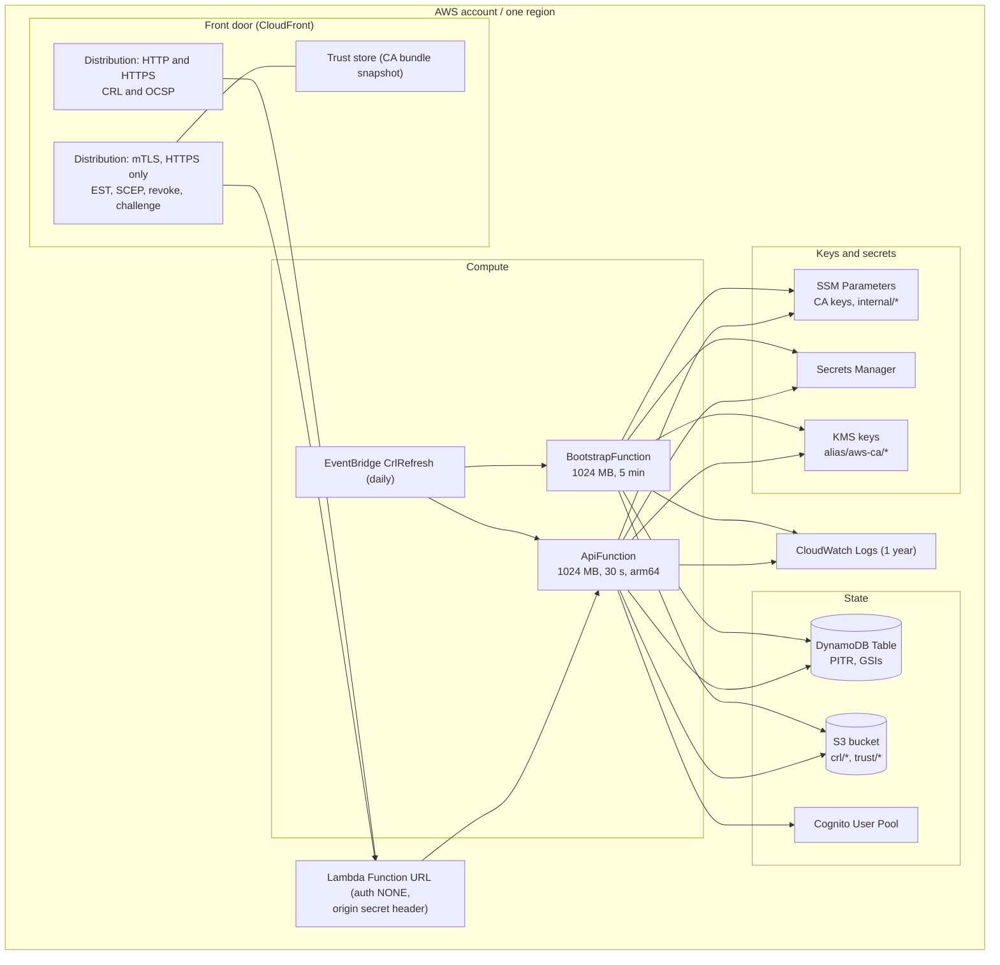

# 7. Deployment View

## 7.1 Infrastructure Level 1

<!-- arc42-generated -->

Everything is one CloudFormation stack, created by `bin/aws-ca.ts` (stack name from
`AWS_CA_STACK_NAME`). The diagram shows the default `cloudfront` front door with mTLS on.

**Motivation:** No VPC, no always-on compute. Two roles with different key access are the main
structural security feature of the topology.

### Building Block to Infrastructure Mapping

| Building Block    | Infrastructure Element                          | Notes                                                                                                                                                                               |
| ----------------- | ----------------------------------------------- | ----------------------------------------------------------------------------------------------------------------------------------------------------------------------------------- |
| Request runtime   | `ApiFunction` (`src/handlers/api.ts`)           | `ApiRole`: DynamoDB single-item ops, `crl/*` get/put, issuing CA keys, explicit root `Deny`.                                                                                        |
| Bootstrap         | `BootstrapFunction` behind a custom resource    | `BootstrapRole`: all keys including root, `internal/*` parameters, trust bundles.                                                                                                   |
| Repository        | DynamoDB `Table`                                | On demand; PITR; TTL attribute; owner and revoked GSIs (`TABLE_SCHEMA`).                                                                                                            |
| CRL store         | S3 `CrlBucket`                                  | Private, SSL enforced, S3-managed encryption; never public. `ApiFunction` reads and serves the CRL (CloudFront's `/crl/*` behavior has the Function URL as origin, not the bucket). |
| Authenticator     | Cognito `UserPool` and `EstClient`              | Lite (default) or Essentials; 14-character password policy; 5-minute tokens; no self sign-up.                                                                                       |
| Key stores        | SSM, Secrets Manager, KMS                       | Chosen per CA; optional stack-created customer-managed key with rotation.                                                                                                           |
| Daily maintenance | EventBridge `CrlRefresh`                        | Targets both functions.                                                                                                                                                             |
| Front door        | CloudFront, or Function URL, HTTP API, REST API | See below.                                                                                                                                                                          |

### Front door options

| Level          | HTTP OCSP/CRL                               | mTLS re-enrollment           | Notes                                                                                               |
| -------------- | ------------------------------------------- | ---------------------------- | --------------------------------------------------------------------------------------------------- |
| `function-url` | no                                          | no                           | HTTPS only; no fixed cost.                                                                          |
| `cloudfront`   | yes (separate distribution when mTLS is on) | yes                          | Default. Public Function URL guarded by an origin secret; a new distribution takes about 7 minutes. |
| `http-api`     | no                                          | yes (custom domain)          | About $1 per million requests; no Function URL is created.                                          |
| `rest-api`     | no                                          | yes (regional custom domain) | `regional` or `private` (private needs an `execute-api` VPC endpoint; no mTLS).                     |

### Environment Overview

| Environment | Purpose              | URL                                                                | Notes                                                                                                   |
| ----------- | -------------------- | ------------------------------------------------------------------ | ------------------------------------------------------------------------------------------------------- |
| Per stack   | One CA deployment    | Stack outputs (`EstEndpoint`, `ScepEndpoint`, `RevocationBaseUrl`) | Environments are separate stack names/accounts; there is no built-in dev/staging/prod split.            |
| Experiments | Throwaway deployment | as above                                                           | `removalPolicy: destroy` removes keys, table and bucket; default `retain` keeps what would lose the CA. |

<!-- /arc42-generated -->

## 7.2 Infrastructure Level 2

<!-- arc42-manual: Detail internal structure of selected infrastructure elements if needed (custom domain, ACM certificate and Route 53 are the deployer's responsibility and are not created here) -->
<!-- /arc42-manual -->
