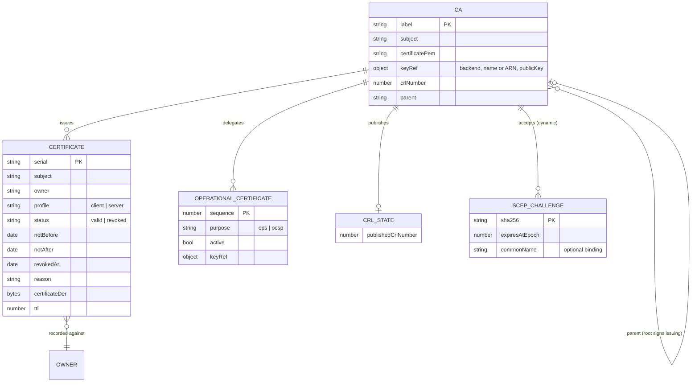

# 8.1 Domain Model

<!-- arc42-generated -->

## Items in the single table

| Item                   | `pk`         | `sk`               | Notes                                                                                         |
| ---------------------- | ------------ | ------------------ | --------------------------------------------------------------------------------------------- |
| CA record              | `CA#<label>` | `META`             | Keyed by label, not DN: a DN changes on renewal, the label is in the endpoint paths.          |
| Certificate            | `CA#<label>` | `CERT#<serial>`    | Written with `attribute_not_exists`; `ttl` set from `notAfter` + `retention.afterExpiryDays`. |
| Operational cert       | `CA#<label>` | `OPS#<sequence>`   | The label is `<ca>-ops` or `<ca>-ocsp`, so those suffixes are reserved from CA labels.        |
| Published CRL          | `CA#<label>` | `CRL`              | Conditional update that only accepts a higher CRL number.                                     |
| Dynamic SCEP challenge | `CA#<label>` | `SCEPOTP#<sha256>` | Only the hash is stored; `expiresAtEpoch` enforced in the condition, `ttl` for cleanup.       |

| Index           | Keys                      | Use                                                          |
| --------------- | ------------------------- | ------------------------------------------------------------ |
| `owner-index`   | `ownerPk` / `ownerSk`     | Re-enrollment and "my certificates"; subject is URL-encoded. |
| `revoked-index` | `revokedPk` / `revokedSk` | Sparse: only revoked certificates; builds the CRL.           |

Both indexes are eventually consistent. The revoke path therefore includes the certificate it has
just revoked in the CRL explicitly.

**Definitions:** see [CONTEXT.md](../../../../CONTEXT.md) and the glossary
([section 12](../../12-glossary.md)). Source of truth for keys: [`src/repo/schema.ts`](../../../../src/repo/schema.ts).

<!-- /arc42-generated -->
