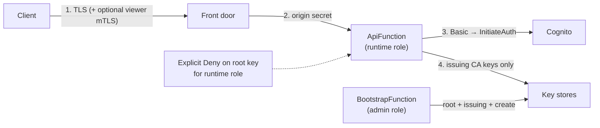

# 8.2 Security and Authentication

This directory holds detailed control-implementation mappings (standard to status) which are
hand-authored, as [ADR 0002](../../../adr/0002-system-design-document.md) requires, and must be
preserved when sections are regenerated. None exist yet. This README summarises the architecture
that those mappings will point at.

## Trust boundaries and key separation

<!-- arc42-generated -->

| Concern                             | Mechanism                                                                                                                                                                           | Where                                                                                    |
| ----------------------------------- | ----------------------------------------------------------------------------------------------------------------------------------------------------------------------------------- | ---------------------------------------------------------------------------------------- |
| Root key never reachable at runtime | Separate roles; runtime role has `Deny` on the root's parameter/secret paths and on `kms:Sign` with the root alias, so a broader policy added later cannot reopen it.               | [lib/permissions.ts](../../../../lib/permissions.ts)                                     |
| Offline root                        | `keyHandling: offline` hands the key over once and deletes it; root CRL is then not refreshed.                                                                                      | [src/bootstrap](../../../../src/bootstrap)                                               |
| Key at rest                         | `aws-managed-key`, `app-encrypted` (AES-256-GCM, HKDF over a random secret in a separate parameter, never in env or template), `customer-managed-key`; KMS keys are non-exportable. | [src/keystore](../../../../src/keystore)                                                 |
| Origin trust                        | Secret header from CloudFront checked first; viewer certificate header and published URLs are believed only after it passes; constant-time compare.                                 | [src/frontdoor/admit.ts](../../../../src/frontdoor/admit.ts)                             |
| Authentication                      | Cognito Basic (`USER_PASSWORD_AUTH`), admin-created users, 14-character password policy, no self sign-up, `preventUserExistenceErrors`, 5-minute tokens.                            | [lib/aws-ca-stack.ts](../../../../lib/aws-ca-stack.ts), [src/auth](../../../../src/auth) |
| Certificate-based renewal           | Chain checked by the front door; status, expiry and owner standing (enabled, still in group) checked by the Lambda against the table and Cognito.                                   | [src/est/handler.ts](../../../../src/est/handler.ts)                                     |
| Authorization                       | Cognito groups map to profiles (`est-client`, `est-server`), revocation (owner or `est-admin`), and SCEP challenges (`scep-admin` or `est-admin`).                                  | [src/policy](../../../../src/policy)                                                     |
| Issuance integrity                  | Subject and names come from policy, never from the CSR; server SANs must be within `allowedDomainSuffixes`; client CN is pinned to the authenticated user.                          | [src/policy/issuance.ts](../../../../src/policy/issuance.ts)                             |
| SCEP challenge                      | Static secret (constant-time compare, in SSM) or dynamic: stored as hash, single use through one conditional delete, expiring, capped, optionally bound to a CN.                    | [src/scep](../../../../src/scep)                                                         |
| Least privilege on data             | Request path: `GetItem`, `Query`, `PutItem`, `UpdateItem`, `DeleteItem` only; S3 `crl/*` only; Cognito read-only lookups for this pool.                                             | [lib/aws-ca-stack.ts](../../../../lib/aws-ca-stack.ts)                                   |
| No secrets in logs                  | Closed log catalogue; unknown fields dropped; OCSP request path cut; client details optional.                                                                                       | [src/log.ts](../../../../src/log.ts)                                                     |
| Infrastructure checks               | `cdk-nag` test over the synthesized stack.                                                                                                                                          | [test/nag.test.ts](../../../../test/nag.test.ts)                                         |

<!-- /arc42-generated -->

## Control mappings

<!-- arc42-manual: Add hand-authored standard-to-status mappings here as separate files (for example an OWASP ASVS or CIS mapping). Do not fold them back into this README. -->
<!-- /arc42-manual -->
