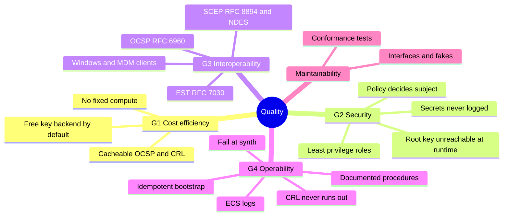

# 10. Quality Requirements

The goals are those of [section 1.2](01-introduction.md): **G1** cost efficiency, **G2** key and
issuance security, **G3** interoperability, **G4** operability and auditability. Every scenario
below names the goal it concretises.

## 10.1 Quality Tree

<!-- arc42-generated -->

<!-- /arc42-generated -->

## 10.2 Quality Scenarios

<!-- arc42-generated -->

| #      | Goal | Quality Attribute | Scenario                              | Stimulus                                        | Response                                                                                                                                  | Metric / Target                                                                      |
| ------ | ---- | ----------------- | ------------------------------------- | ----------------------------------------------- | ----------------------------------------------------------------------------------------------------------------------------------------- | ------------------------------------------------------------------------------------ |
| S10-1  | G1   | Cost              | Idle deployment with default settings | No traffic for a month                          | No per-month charge from keys (`parameter` backend), compute, table or Cognito Lite within free tiers.                                    | Fixed cost close to zero; confirm on the bill (CloudFront mTLS pricing unconfirmed). |
| S10-2  | G2   | Security          | Runtime role is compromised           | Attacker can run code as `ApiRole`              | Cannot read root key parameters/secrets or `kms:Sign` with the root alias (explicit `Deny`); can issue only through the issuing CA's key. | Root key never in the runtime role's reach.                                          |
| S10-3  | G3   | Interoperability  | Windows enrolls over SCEP             | `Get-SCEPCertificate` with a challenge          | Root is in `GetCACert`; NDES page byte-compatible with Windows Server 2025; enrollment and renewal succeed.                               | Verified with PSCertificateEnrollment; MDM parsing not verified.                     |
| S10-4  | G3   | Interoperability  | EST client enrolls                    | `curl`/`certreq` with Basic and PKCS#10         | Certs-only PKCS#7 with leaf and issuing CA; ECDSA P-256 CSR from the Microsoft KSP accepted.                                              | Conformance tests with OpenSSL.                                                      |
| S10-5  | G4   | Reliability       | CRL freshness                         | No revocations for a week                       | Daily rule rebuilds each CRL; a failure makes the invocation error.                                                                       | CRL age < `crl.nextUpdateDays` (7).                                                  |
| S10-6  | G4   | Auditability      | A certificate is issued or refused    | Any enrollment                                  | One structured record with user, CA, protocol, profile, serial, subject or refusal reason.                                                | 100% of issuances and refusals logged; no secrets in records.                        |
| S10-7  | G2   | Integrity         | Concurrent revocations                | Two revokes race                                | Both appear in the CRL; the higher CRL number always wins publication.                                                                    | No lost entries, no older CRL replaces a newer one.                                  |
| S10-8  | G4   | Reliability       | Concurrent or repeated bootstrap      | Deploy twice at once                            | One CA wins; loser deletes its own key; nothing duplicated.                                                                               | One record per label.                                                                |
| S10-9  | G2   | Security          | Revocation latency through OCSP       | Revoke while CloudFront has the response cached | Answers are stale up to `ocsp.maxAgeSeconds`.                                                                                             | ≤ 3600 s default; `0` for immediate.                                                 |
| S10-10 | G3   | Performance       | SCEP renewal on a cold start          | First request after idle                        | Completes within the function timeout.                                                                                                    | 30 s timeout, 1024 MB (3 s default was too short).                                   |

<!-- /arc42-generated -->

<!-- arc42-manual: Add quality scenarios based on stakeholder interviews (availability target, expected request volume, RPO/RTO) -->
<!-- /arc42-manual -->
